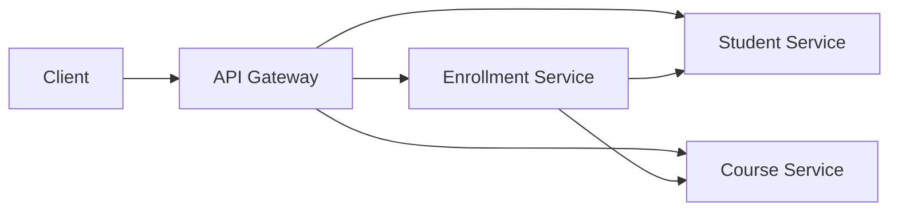

# ออกแบบสถาปัตยกรรม Microservices ของ Student API

## 1. การแบ่งบริการ

แบ่งบริการตามหน้าที่ทางธุรกิจ (Bounded Context) โดยแต่ละบริการรับผิดชอบข้อมูลของตนเอง

| บริการ             | ความรับผิดชอบ                                  | Endpoint หลัก                                                |
| ------------------ | ---------------------------------------------- | ------------------------------------------------------------ |
| API Gateway        | รับ Request และส่งต่อไปยังบริการที่เกี่ยวข้อง  | `/api/v1/students`, `/api/v1/courses`, `/api/v1/enrollments` |
| Student Service    | จัดการข้อมูลนิสิต เพิ่ม แก้ไข ลบ และค้นหานิสิต | `/api/v1/students`                                           |
| Course Service     | จัดการข้อมูลรายวิชา                            | `/api/v1/courses`                                            |
| Enrollment Service | จัดการการลงทะเบียนเรียนและตรวจสอบจำนวนที่นั่ง  | `/api/v1/enrollments`                                        |

## 2. แผนภาพสถาปัตยกรรม



## 3. รูปแบบการสื่อสาร

| จาก                | ไป                 | รูปแบบ      | เหตุผล                                     |
| ------------------ | ------------------ | ----------- | ------------------------------------------ |
| Client             | API Gateway        | Synchronous | ต้องได้รับผลลัพธ์กลับมา                    |
| API Gateway        | Student Service    | Synchronous | ต้องแสดงข้อมูลนิสิตหรือผลการแก้ไขทันที     |
| API Gateway        | Course Service     | Synchronous | ต้องแสดงข้อมูลรายวิชาทันที                 |
| API Gateway        | Enrollment Service | Synchronous | ต้องทราบผลการลงทะเบียนทันที                |
| Enrollment Service | Student Service    | Synchronous | ตรวจสอบว่านิสิตมีอยู่จริงก่อนลงทะเบียน     |
| Enrollment Service | Course Service     | Synchronous | ตรวจสอบรายวิชาและจำนวนที่นั่งก่อนลงทะเบียน |

ระบบนี้ใช้ Synchronous เป็นหลัก เพราะต้องตรวจสอบข้อมูลและแจ้งผลทันที ส่วน Asynchronous สามารถใช้ในอนาคตสำหรับงานแจ้งเตือนหรือส่งอีเมลที่ไม่ต้องรอผลทันที

## 4. จุดที่ต้องมี Resilience

| บริการที่เรียก     | บริการปลายทาง      | แนวทาง                                                    | เหตุผล                                 |
| ------------------ | ------------------ | --------------------------------------------------------- | -------------------------------------- |
| API Gateway        | Student Service    | Timeout, Retry แบบจำกัด และ Fallback เป็น HTTP 503        | ป้องกัน Gateway ค้างเมื่อบริการล่ม     |
| API Gateway        | Course Service     | Timeout, Retry แบบจำกัด และ Fallback เป็น HTTP 503        | ป้องกันการรอนานเกินไป                  |
| API Gateway        | Enrollment Service | Timeout, Retry อย่างระมัดระวัง และ Fallback เป็น HTTP 503 | ป้องกัน Request ค้างและการลงทะเบียนซ้ำ |
| Enrollment Service | Student Service    | Timeout และ Retry แบบจำกัด                                | ป้องกันการรอผลตรวจสอบนิสิตนานเกินไป    |
| Enrollment Service | Course Service     | Timeout และ Retry แบบจำกัด                                | ป้องกันการรอผลตรวจสอบรายวิชานานเกินไป  |

เมื่อ Student Service ไม่พร้อมใช้งาน Gateway ควรตอบกลับด้วย HTTP `503 Service Unavailable` พร้อมข้อความที่เข้าใจง่าย โดยไม่ค้างหรือ Crash และไม่ควรแสดงผลสำเร็จปลอม ๆ

ตัวอย่าง Response:

```json
{
  "error": "SERVICE_UNAVAILABLE",
  "message": "Student Service is temporarily unavailable"
}
```

## สรุป

ระบบแบ่งเป็น Student Service, Course Service และ Enrollment Service โดยใช้ API Gateway เป็นจุดรับ Request กลาง และใช้ Synchronous สำหรับงานที่ต้องทราบผลทันที พร้อมกำหนด Timeout, Retry และ Fallback เพื่อให้ระบบรับมือกับความผิดพลาดได้อย่างเหมาะสม
